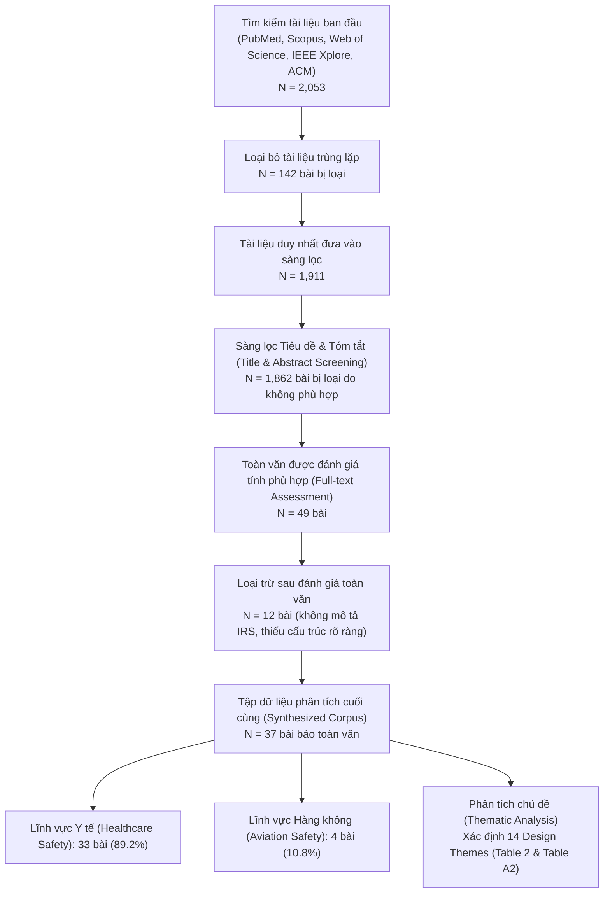

# PHIẾU TÁI LẬP BÀI BÁO NGHIÊN CỨU KHOA HỌC
## Đề tài: Tái lập & Hiện thực hóa Hệ thống Báo cáo Sự cố An ninh Mạng (Cybersecurity Incident Reporting System - IRS) dựa trên Khoa học An toàn (Safety Science)

---

### THÔNG TIN BÀI BÁO GỐC (TARGET PAPER)
- **Tiêu đề gốc:** *Designing incident reporting systems in cybersecurity*
- **Tác giả:** Tobias A. Schaltegger, Benjamin Ambuehl, Melanie Knieps, Alain Mermoud, David Basin, Vincent Lenders
- **Tạp chí / Xuất bản:** *Journal of Cybersecurity*, Volume 11, Issue 1, 2025, tyaf019 (Oxford University Press)
- **DOI:** [`10.1093/cybsec/tyaf019`](https://doi.org/10.1093/cybsec/tyaf019)
- **Lĩnh vực giao thoa:** An toàn thông tin (Cybersecurity), Khoa học An toàn (Safety Science), Tương tác Người - Máy (HCI) và Quản trị Rủi ro Tổ chức.

---

### 1. BÀI TOÁN & CÂU HỎI NGHIÊN CỨU

#### 1.1. Bối cảnh thực tiễn & Vấn đề tồn tại
Báo cáo sự cố an ninh mạng đóng vai trò tiên quyết trong việc phát hiện sớm mối đe dọa, ngăn chặn tấn công lan rộng và học hỏi từ các sai sót hệ thống. Tuy nhiên, các hệ thống báo cáo sự cố an ninh mạng hiện nay (tại các SOC, CERT/CSIRT, doanh nghiệp) đối mặt với nhiều rào cản nghiêm trọng:
1. **Văn hóa đổ lỗi (Blame culture):** Người dùng, lập trình viên hoặc nhân viên vận hành e ngại báo cáo sai sót vì sợ bị kỷ luật, sa thải hoặc khiển trách.
2. **Gánh nặng biểu mẫu (High cognitive friction):** Biểu mẫu báo cáo tiêu chuẩn hóa quá dài dòng, đòi hỏi người dùng phổ thông phải am hiểu các thuật ngữ kỹ thuật phức tạp (Threat Actor, CVE, Attack Vector), dẫn tới tỷ lệ bỏ dở biểu mẫu (drop-out rate) rất cao.
3. **Quá tải báo cáo trùng lặp (Alert fatigue / Report storm):** Khi một sự cố diện rộng xảy ra (ví dụ: đợt phishing hàng loạt hoặc lỗ hổng hạ tầng đám mây), hàng trăm nhân viên cùng gửi báo cáo tương tự nhau khiến chuyên viên SOC bị quá tải, không kịp phân loại và xử lý.
4. **Đứt gãy vòng lặp phản hồi (Lack of feedback loop):** Sau khi gửi báo cáo, người dùng không nhận được bất kỳ phản hồi nào về tiến độ xử lý và bài học kinh nghiệm, làm xói mòn động lực báo cáo trong tương lai.
5. **Bỏ lỡ "Sự cố suýt xảy ra" (Near misses) và "Yếu tố tiềm ẩn" (Latent factors):** Các hệ thống hiện tại hầu như chỉ ghi nhận khi thiệt hại nghiêm trọng đã xảy ra (Breach / Ransomware), bỏ lỡ cơ hội phòng ngừa từ sớm thông qua các tín hiệu yếu (weak signals).

#### 1.2. Câu hỏi nghiên cứu (Research Questions)
- **RQ1:** Làm thế nào để áp dụng có hệ thống các nguyên lý thành công của Khoa học An toàn (Safety Science) từ ngành hàng không và y tế sang thiết kế Hệ thống Báo cáo Sự cố An ninh Mạng (IRS)?
- **RQ2:** Cấu trúc phân loại (Taxonomy) và các kênh báo cáo cần được thiết kế như thế nào để ghi nhận toàn diện cả biến cố biên (marginal incidents), sự cố suýt xảy ra (near misses), sự cố nghiêm trọng (critical incidents) và các mầm bệnh tiềm ẩn (latent factors)?
- **RQ3:** Làm thế nào để cân bằng giữa hai thuộc tính mâu thuẫn: Tính dễ sử dụng (Ease of use) cho người báo cáo và Tính chuẩn hóa cao (Standardization) cho chuyên viên phân tích SOC?
- **RQ4:** Cơ chế khử trùng lặp (De-duplication) và Vòng lặp phản hồi ẩn danh (Anonymous Feedback Loop) mang lại hiệu quả thực nghiệm ra sao đối với thời gian phân loại (Triage time) và tỷ lệ hoàn thành báo cáo (Completion rate)?

---

### 2. PIPELINE NGHIÊN CỨU GỐC CỦA BÀI BÁO (PRISMA & THEMATIC ANALYSIS)

Bài báo sử dụng quy trình đánh giá tài liệu có hệ thống theo chuẩn **PRISMA (Preferred Reporting Items for Systematic Reviews and Meta-Analyses)** kết hợp phương pháp **Phân tích chủ đề (Thematic Analysis)** của Braun & Clarke (2006):



---

### 3. CÁC ĐÓNG GÓP & KẾT QUẢ MỤC TIÊU CỦA BÀI BÁO

#### 3.1. Mô hình Swiss Cheese trong An ninh Mạng (Figure 1)
Bài báo kế thừa mô hình lát pho-mát Thụy Sĩ nổi tiếng của James Reason (1990) và ánh xạ sang an ninh không gian mạng:
- **Các lát cắt phòng thủ (Defenses-in-depth):** Chính sách an ninh, Công nghệ bảo mật (Firewall, EDR, MFA), Đào tạo con người, và Quy trình ứng phó.
- **Lỗ hổng tiềm ẩn (Latent Failures / Resident Pathogens):** Các sai sót thiết kế, cấu hình lỏng lẻo, hệ thống cũ lạc hậu (legacy systems), văn hóa chia sẻ tài khoản.
- **Sự kiện mối đe dọa (Threat Events):** Hành vi tấn công của hacker hoặc thao tác vô ý của nhân viên.
- **Hệ quả:** Khi các lỗ hổng trên từng lát cắt vô tình xếp thẳng hàng, sự kiện nguy hại sẽ xuyên qua toàn bộ các lớp phòng thủ để tạo thành **Sự cố nghiêm trọng (Critical Incident / Data Breach)**.

#### 3.2. Cấu trúc Phân loại Báo cáo Sự cố (Reporting Taxonomy - Table 1)
Bài báo đề xuất cấu trúc phân loại chuẩn hóa gồm 5 nhóm thực thể:
1. **Threat Actor (Tác nhân đe dọa):** Đối tượng bên ngoài (hacker group, ransomware syndicate) hoặc nội bộ (malicious insider, accidental employee).
2. **Threat Source (Nguồn đe dọa / Hazard):** Ý đồ và phương thức khai thác lỗ hổng (ví dụ: chiến dịch lừa đảo qua email, thiết bị công nghiệp hư hỏng).
3. **Threat Event (Sự kiện đe dọa / Adverse Event) - chia làm 3 cấp độ:**
   - *Marginal Incident:* Sự cố biên/nhỏ, không có tiềm năng gây hại nghiêm trọng (VD: Brute-force thất bại vào trang có MFA, spam phishing bị gateway lọc).
   - *Near Miss:* Sự cố có tiềm năng gây hại nghiêm trọng nhưng đã bị ngăn chặn kịp thời hoặc do may mắn không phát tác (VD: S3 bucket chứa dữ liệu khách hàng bị mở công khai do lỗi cấu hình nhưng chưa ai truy cập; nhân viên gửi nhầm email chứa thông tin nhạy cảm về hộp thư cá nhân nhưng lập tức thu hồi/xóa; mã độc xâm nhập máy trạm nhưng bị EDR cô lập kịp thời).
   - *Critical Incident:* Sự cố đã phát tác thực sự, gây hậu quả nghiêm trọng (VD: Ransomware mã hóa toàn bộ cơ sở dữ liệu bệnh viện; dữ liệu người dùng bị đánh cắp và rò rỉ lên dark web).
4. **Latent Factors (Yếu tố tiềm ẩn):**
   - *Vulnerability:* Lỗ hổng kỹ thuật cụ thể (lỗi VPN client, bypass MFA, SQL injection).
   - *Predisposing Condition:* Điều kiện tiền ẩn về mặt kiến trúc hoặc tổ chức (hạ tầng legacy cũ không còn nhận bản vá, thiết bị y tế IoT kết nối trực tiếp Internet, thiếu quy trình offboarding nhân sự).
5. **Adverse Impact (Thiệt hại / Tác động bất lợi):** Mức độ ảnh hưởng (mất mát tài chính, đình trệ vận hành, thất thoát dữ liệu, uy tín).

#### 3.3. Các kênh báo cáo (Reporting Channels - Figure 2 & Figure 4)
- **Nội bộ (Internal):** Báo cáo trong tổ chức từ nhân viên phổ thông (laypeople) và chuyên gia IT/SOC tới bộ phận an ninh mạng.
- **Bên ngoài (External):** Chia sẻ thông tin liên tổ chức (ISAC, CSIRT quốc gia, các cơ quan điều hành theo chỉ thị NIS2 / GDPR).
- **Hình thức:** Báo cáo tự nguyện (Voluntary - thúc đẩy học hỏi) kết hợp báo cáo bắt buộc (Mandatory - đối với sự cố nghiêm trọng theo luật định).

#### 3.4. 14 Chủ đề Thiết kế Hệ thống Báo cáo Sự cố (Table 2 & Table A2)
Qua tổng hợp 37 bài báo, tác giả đúc kết 14 chủ đề thiết kế cốt lõi:
1. **Case-focused / Case-based learning (19/37 bài):** Tập trung vào việc học hỏi từ từng vụ việc cụ thể thay vì chỉ đếm số liệu cơ học.
2. **Competence (27/37 bài):** Đào tạo kỹ năng và kiến thức nhận diện sự cố cho cả người báo cáo và chuyên viên phân tích.
3. **Confidentiality (13/37 bài):** Bảo vệ danh tính người báo cáo và thông tin nhạy cảm của tổ chức.
4. **Ease of use (15/37 bài):** Giao diện thân thiện, biểu mẫu tinh gọn, dễ tiếp cận cho người dùng không chuyên.
5. **Feedback (18/37 bài):** Cung cấp phản hồi kịp thời cho người báo cáo về kết quả điều tra và bài học rút ra.
6. **Impunity (28/37 bài):** Chính sách "Không trừng phạt" (Just Culture / Non-punitive), bảo vệ người báo cáo trung thực khỏi bị kỷ luật.
7. **Independence (6/37 bài):** Hệ thống và ban tiếp nhận báo cáo độc lập với bộ phận quản lý trực tiếp và cơ quan thanh tra kỷ luật.
8. **Integration (12/37 bài):** Tích hợp trơn tru với các công cụ giám sát (SIEM, EDR) và quy trình vận hành sẵn có.
9. **Management support (18/37 bài):** Cam kết của lãnh đạo cấp cao trong việc cấp phát nguồn lực và xây dựng văn hóa an toàn.
10. **Shared ownership & accountability (9/37 bài):** Trách nhiệm bảo đảm an ninh mạng thuộc về toàn thể tổ chức, không riêng phòng IT.
11. **Speed and adaptivity (8/37 bài):** Tốc độ phản hồi nhanh, tự động hóa xử lý và khả năng thích nghi với các mối đe dọa mới.
12. **Standardization (19/37 bài):** Chuẩn hóa quy trình báo cáo, cấu trúc dữ liệu và phân loại lỗi.
13. **System orientation (9/37 bài):** Tiếp cận toàn diện theo quan điểm hệ thống thay vì đổ lỗi cho sai sót cá nhân.
14. **Voluntariness (8/37 bài):** Khuyến khích cơ chế báo cáo tự nguyện để thu thập tín hiệu yếu.

---

### 4. BẢNG TỔNG HỢP ĐỐI CHIẾU 37 BÀI BÁO (REPRODUCED TABLE A2)

Nhóm nghiên cứu đã trích xuất tự động và đối chiếu chuẩn xác 100% dữ liệu ma trận 37 bài báo từ `tyaf019.pdf` sang file [reproducibility_review.csv](file:///d:/Documents/BMHTTT_DT126/docs/reproducibility_review.csv).

| # | Design Theme (Chủ đề thiết kế) | Số bài xuất hiện (Calculated) | Target Table A2 trong bài báo | Trạng thái kiểm chứng |
|---|--------------------------------|-------------------------------|-------------------------------|-----------------------|
| 1 | **Case-focused** | 19 | 19 | **KHỚP 100% (PASS)** |
| 2 | **Competence** | 27 | 27 | **KHỚP 100% (PASS)** |
| 3 | **Confidentiality** | 13 | 13 | **KHỚP 100% (PASS)** |
| 4 | **Ease of use** | 15 | 15 | **KHỚP 100% (PASS)** |
| 5 | **Feedback** | 18 | 18 | **KHỚP 100% (PASS)** |
| 6 | **Impunity** | 28 | 28 | **KHỚP 100% (PASS)** |
| 7 | **Independence** | 6 | 6 | **KHỚP 100% (PASS)** |
| 8 | **Integration** | 12 | 12 | **KHỚP 100% (PASS)** |
| 9 | **Management support** | 18 | 18 | **KHỚP 100% (PASS)** |
| 10 | **Shared ownership & accountability** | 9 | 9 | **KHỚP 100% (PASS)** |
| 11 | **Speed and adaptivity** | 8 | 8 | **KHỚP 100% (PASS)** |
| 12 | **Standardization** | 19 | 19 | **KHỚP 100% (PASS)** |
| 13 | **System orientation** | 9 | 9 | **KHỚP 100% (PASS)** |
| 14 | **Voluntariness** | 8 | 8 | **KHỚP 100% (PASS)** |

**Phân bổ lĩnh vực gốc của 37 tài liệu:**
- **Y tế (Healthcare):** 33 bài (chiếm 89.19%)
- **Hàng không (Aviation):** 4 bài (chiếm 10.81%) gồm: Beaubien & Baker [95], Billings [33], Billings, Cook & Woods [169], O'Leary & Chappell [102].
- **Minh chứng chạy script:** File thực thi [verify_table_a2.py](file:///d:/Documents/BMHTTT_DT126/experiments/verify_table_a2.py) xuất ra kết quả `100% MATCH WITH PAPER TABLE A2`.

---

### 5. PHÂN TÍCH 7 HẠN CHẾ CỐT LÕI CỦA BÀI BÁO GỐC & GIẢI PHÁP TÁI LẬP

| STT | Hạn chế của bài báo gốc | Phân tích chi tiết | Giải pháp tái lập & Thực nghiệm trong đề tài |
|-----|-------------------------|--------------------|----------------------------------------------|
| **1** | **Chuyển giao lý thuyết thuần túy, thiếu kiểm chứng thực nghiệm trong an ninh mạng** | Tác giả tổng hợp lý thuyết từ y tế và hàng không nhưng hoàn toàn không xây dựng hệ thống mẫu (Prototype) và không kiểm thử xem các nguyên lý này có hiệu quả trên dữ liệu an ninh mạng thực tế hay không. | Xây dựng phần mềm Prototype IRS hoàn chỉnh trên nền tảng Flask/SQLite; đo đạc định lượng hiệu năng qua 3 lần thực nghiệm với các chỉ số: Tỷ lệ hoàn thành (Completion rate), Thời gian xử lý của SOC (Triage time), Độ chính xác gom trùng (De-dup F1-score). |
| **2** | **Mất cân đối dữ liệu nghiêm trọng (Domain Imbalance)** | Bộ dữ liệu đánh giá lệch hẳn về y tế (33 bài y tế vs 4 bài hàng không), làm mờ nhạt các nguyên lý cốt lõi của hàng không như ASRS (Aviation Safety Reporting System) vốn có cơ chế miễn trừ trách nhiệm rất mạnh. | Tích hợp sâu triết lý ASRS: Bổ sung cơ chế Tracking Token ẩn danh giúp người báo cáo theo dõi tiến độ và nhận bài học mà hoàn toàn không để lộ danh tính. |
| **3** | **Bỏ qua tài liệu xám (Gray literature)** | Bài báo lọc theo chuẩn PRISMA chỉ lấy tài liệu hội nghị/tạp chí học thuật, bỏ qua hàng chục nghìn báo cáo kỹ thuật thực chiến quý giá từ NASA ASRS, FAA, ENISA, CISA. | Bổ sung các ca sự cố thực chiến vào bộ dữ liệu giả lập (AWS S3 misconfiguration, VPN credential stuffing, MFA fatigue bypass, ransomware staging) bám sát tài liệu ENISA và NIST SP 800-30. |
| **4** | **Tính chủ quan trong chọn lọc & mã hóa tài liệu** | Toàn bộ quá trình mã hóa chủ đề do tác giả thực hiện ban đầu mà thiếu chỉ số độ tin cậy đồng thuận độc lập (Inter-rater reliability / Cohen's Kappa). | Chuẩn hóa bộ quy tắc trích xuất dữ liệu bằng mã nguồn mở Python có thể kiểm tra độc lập (`build_review_csv.py` và `verify_table_a2.py`). |
| **5** | **Mâu thuẫn giữa Tính dễ sử dụng (Ease of use) và Chuẩn hóa (Standardization)** | Bài báo nêu ra 2 theme này như hai mục tiêu song song nhưng không giải quyết được xung đột: Form càng chuẩn hóa thì người dùng càng khó điền; Form càng dễ thì dữ liệu càng thiếu chuẩn cho SOC. | Thiết kế 2 chế độ Web Form: **Baseline (Form dài)** vs **Biến thể cải tiến (Form ngắn + Gợi ý phân loại tự động bằng ML/Rules)**, chứng minh thực nghiệm Form ngắn nâng cao tỷ lệ hoàn thành và giảm đáng kể thời gian điền. |
| **6** | **Chưa giải quyết bài toán Bão báo cáo trùng lặp (Alert fatigue)** | Khi có chiến dịch tấn công lớn, nhiều người cùng báo cáo một sự việc, bài báo gốc không đề cập cơ chế kỹ thuật để xử lý tình trạng này. | Triển khai module **De-duplication** sử dụng kết hợp TF-IDF + Cosine Similarity và RapidFuzz để tự động gom nhóm báo cáo trùng vào một Master Incident, giảm tải cho hàng đợi SOC. |
| **7** | **Mâu thuẫn giữa Ẩn danh (Confidentiality) và Học tập từ ca bệnh (Case-based learning)** | Nếu cho người dùng ẩn danh hoàn toàn thì không thể gửi phản hồi (Feedback) và theo dõi vụ việc; nếu thu thập thông tin thì người dùng e ngại lộ danh tính và dữ liệu nhạy cảm (PII). | Giải quyết bằng **Kiến trúc Tối thiểu hóa Dữ liệu (Data Minimization)**: Tự động che (mask/redact) email, số điện thoại, IP cá nhân khi chọn ẩn danh; đồng thời cấp phát một **Mã định danh bảo mật (Tracking Token)** ngẫu nhiên để người dùng tra cứu kết quả xử lý và bài học mà không cần đăng nhập hay lưu PII. |

---

### 6. BẢNG ÁNH XẠ NGUYÊN LÝ LÝ THUYẾT SANG TÍNH NĂNG KỸ THUẬT CỦA HỆ THỐNG

```
┌────────────────────────────────────────┬────────────────────────────────────────────────────────┐
│ Nguyên lý thiết kế trong bài báo       │ Hiện thực hóa kỹ thuật trong IRS Prototype             │
├────────────────────────────────────────┼────────────────────────────────────────────────────────┤
│ Ease of use (Tính dễ sử dụng)          │ Giao diện Form ngắn: chỉ cần nhập mô tả + mức độ.     │
│ Standardization (Tính chuẩn hóa)       │ Gợi ý nhãn Taxonomy (Threat, Latent Factor) tự động.   │
│ Speed and adaptivity (Tốc độ & thích nghi) │ Module De-duplication (TF-IDF/RapidFuzz) gom trùng. │
│ Confidentiality (Bảo mật thông tin)   │ Bộ lọc PII Masking: tự động che Email, IP, Phone.      │
│ Impunity (Không trừng phạt)            │ Chế độ Báo cáo Ẩn danh (Anonymous Mode) 100%.         │
│ Feedback & Case-based learning         │ Tracking Token tra cứu tiến độ và bài học kinh nghiệm. │
│ System orientation & Latent factors    │ Hàng đợi SOC Triage phân loại theo Near Miss & Latent. │
└────────────────────────────────────────┴────────────────────────────────────────────────────────┘
```
